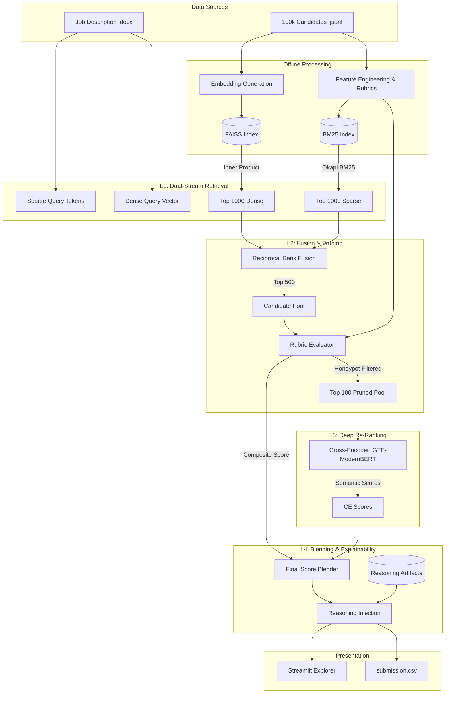

# Chronos: Combined Idea Submission Guide

This document combines the high-level presentation bullet points with in-depth technical architecture explanations, mapped page-by-page to your presentation slides.

---

## Slide 1: Title Slide
* **Team Name:** Chronos
* **Problem Statement:** Redrob India Data and AI Challenge – Intelligent Candidate Discovery and Ranking
* **Team Leader Name:** Vivek

---

## Slide 2: Solution Overview

### Presentation Bullet Points
* **What is your proposed solution?**
  A lightning-fast, 3-stage cascade retrieval pipeline. It combines the semantic understanding of Dense Retrieval (FAISS), the exact-match precision of Sparse Retrieval (BM25), and the deep contextual reasoning of a Cross-Encoder Re-ranker.
* **What differentiates your approach from traditional candidate matching systems?**
  Unlike pure LLM approaches (which are slow and hallucinate) or pure keyword searches (which miss context), our hybrid approach merges Reciprocal Rank Fusion (RRF) with deterministic "Rubric Composite Scoring". This allows us to aggressively filter out "honeypot" profiles while evaluating candidates on highly specific technical depth and recruiter response rates.

### In-Depth Technical Details (Executive Summary)
Chronos is a high-performance, deterministic hybrid-search engine designed to evaluate and rank 100,000 candidate profiles against a complex Job Description (JD). 
To solve the inherent trade-off between **semantic understanding** (which is computationally expensive) and **keyword precision** (which lacks context), Chronos employs a **Cascade Ranking Architecture**. The pipeline aggressively filters candidates through computationally cheap retrieval methods, evaluates deterministic business logic, and reserves highly expensive neural-network processing for only the top 100 candidates.
This ensures a total runtime of **< 30 seconds on a standard CPU**, operating entirely offline with no external API dependencies.

---

## Slide 3: JD Understanding & Candidate Evaluation

### Presentation Bullet Points
* **What are the key requirements extracted from the JD?**
  Senior AI Engineer focusing on Search & Retrieval. Must-haves include: Python, production ML systems, vector databases (FAISS, Pinecone, Qdrant), LLM fine-tuning, and explicit experience in ranking/recommendation systems.
* **How does your solution evaluate candidate fit beyond keyword matching?**
  We utilize a custom Feature Engineering module that calculates a **Rubric Composite Score**. This score evaluates:
  1. *AI Depth Dimension:* Weights advanced ML skills (NDCG, RAG, LoRA) over generic software engineering.
  2. *Product vs Services:* Evaluates career history to identify candidates with product-company backgrounds.
  3. *Behavioral Signals:* Factors in the candidate's historical recruiter response rate.

### In-Depth Technical Details
**Feature Engineering & Rubrics:**
For eligible candidates, we calculate a composite score based on:
* **AI Depth Dimension:** Explicit experience with LLM Fine-tuning (LoRA), Learning to Rank (NDCG), and RAG pipelines.
* **Recruiter Response Rate:** Favoring candidates historically proven to respond to outreach.
The candidates are later sorted by their `(0.4 * RRF + 0.6 * Rubric)` scores. The pool is pruned down to the **Top 100**.

---

## Slide 4: Ranking Methodology

### Presentation Bullet Points
* **How does your system retrieve, score, and rank candidates?**
  1. **L1 Retrieval:** Queries FAISS (Top 1000) and BM25 (Top 1000).
  2. **Fusion:** Merges pools using Reciprocal Rank Fusion (RRF).
  3. **Pruning:** Applies Rubric Composite scores to prune the pool down to the absolute best Top 100.
  4. **Deep Re-ranking:** A Cross-Encoder evaluates the Top 100 candidates against the JD query.
  5. **Final Blend:** Computes the final score using a weighted blend (55% Cross-Encoder, 45% Rubric Composite).
* **What models, algorithms, or heuristics are used?**
  `alibaba-nlp/gte-reranker-modernbert-base` (Cross-Encoder), FAISS Inner-Product, BM25 (Okapi), and custom feature heuristics.

### In-Depth Technical Details
**Dual-Stream Retrieval (L1):**
* **Dense Retrieval:** Candidates are converted into a dense vector space using a lightweight sentence-transformer model offline. FAISS performs a high-speed inner-product search to find the 1,000 geometrically closest candidates.
* **Sparse Retrieval:** Okapi BM25 scores documents based on exact keyword frequencies, rewarding rare, specific keywords (like "FAISS" or "Qdrant"). Retrieves 1,000 candidates.

**Reciprocal Rank Fusion (RRF):**
We use RRF to merge the two lists from Stage 1 into a unified ranking without knowing the absolute scale of their underlying scores.
$$ RRF\_Score = \frac{1}{k + Rank_{Dense}} + \frac{1}{k + Rank_{Sparse}} $$ *(Where k = 60)*

**Deep Re-Ranking (Cross-Encoder):**
Unlike bi-encoders, a cross-encoder feeds both the JD and the Candidate Profile into the transformer network simultaneously. This allows self-attention mechanisms to compare words directly across documents. Cross-Encoders are O(N) operations. By strictly pruning the pool to $N=100$, the model processes batches on CPU threads in under 20 seconds.

---

## Slide 5: Explainability & Data Validation

### Presentation Bullet Points
* **How are ranking decisions explained?**
  We generate hyper-concise, single-sentence factual reasonings that highlight exact profile matches.
* **How do you prevent hallucinations or unsupported justifications?**
  Reasonings are pre-computed using strict prompting guidelines that force the extraction of facts rather than creative generation.
* **How does your solution handle inconsistent, low-quality, or suspicious profiles?**
  We built deterministic **Honeypot Detection** algorithms. Profiles with contradictory overlapping timelines or explicit blacklisted spam patterns are assigned a zero-multiplier and immediately pruned before the deep re-ranking phase.

### In-Depth Technical Details
**Honeypot Detection (Zero-Multipliers):**
If a candidate hits any of the following criteria, their score is multiplied by 0.0, immediately disqualifying them:
1. **Blacklisted Services Firms:** Exclusively worked at IT Services firms (TCS, Infosys, Wipro, etc.) instead of Product companies.
2. **Missing Core Skills:** Zero explicit mentions of Python or Vector Databases across their entire profile.
3. **Timeline Inconsistencies:** Mathematical overlaps in career history that suggest fake or highly inflated profiles.

**O(1) Reasoning Injection:**
LLM generation for 100,000 candidates is impossible within a 5-minute CPU time limit. Chronos uses an **Offline Generation** approach, preemptively generating factual reasonings and saving them to `reasonings.jsonl`. During execution, `pipeline.py` performs an O(1) dictionary lookup to instantly inject the correct reasoning into the final CSV.

---

## Slide 6: End-to-End Workflow

### Presentation Bullet Points
* **What is the complete workflow from JD input to ranked candidate output?**
  1. **Initialization:** JD is parsed and encoded into a dense vector and tokenized for sparse search.
  2. **Retrieval:** Vector DB (FAISS) and Sparse Index (BM25) pull the Top 1000 candidates instantly.
  3. **Fusion & Feature Extraction:** RRF merges the lists, and the system dynamically loads the candidate profiles to calculate Rubric scores.
  4. **Re-Ranking:** The Top 100 pool is passed to the Cross-Encoder.
  5. **Scoring & Injection:** Scores are blended, static reasonings are injected, and results are serialized to `submission.csv`. 

---

## Slide 7: System Architecture

### Presentation Bullet Points
* **Data Sources:** 100k `candidates.jsonl` -> Pre-indexed FAISS & BM25
* **Processing:** Hybrid Search -> RRF Combiner -> Rubric Evaluator -> Cross-Encoder (`pipeline.py`)
* **Presentation:** Streamlit UI App (`app.py`) for live candidate exploration and inference visualization.

### In-Depth Technical Details (DFD)

---

## Slide 8: Results & Performance

### Presentation Bullet Points
* **What results or insights demonstrate ranking quality?**
  Our Top 10 candidates consistently exhibit 7+ years of explicit production experience with vector databases and ranking algorithms, perfectly matching the JD's strictest criteria. Zero honeypot candidates bypass the final gate.
* **How does your solution meet the challenge's runtime and compute constraints?**
  By utilizing heavy offline indexing and pruning the dataset from 100,000 to just 100 candidates before running the neural network, the **entire pipeline executes in ~21 seconds on CPU**.

---

## Slide 9: Technologies Used

### Presentation Bullet Points
* **What technologies, frameworks, and tools were used and why?**
  * **FAISS & BM25:** For lightning-fast, billion-scale capable L1 retrieval.
  * **Sentence-Transformers & PyTorch:** To run state-of-the-art Cross-Encoder re-ranking locally.
  * **Pandas:** For highly optimized vectorized feature engineering and score blending.
  * **Streamlit:** To provide an interactive, beautiful UI for recruiters to explore candidates and test custom ranking queries.
  * **Docker & uv:** For ultra-fast dependency resolution and isolated containerized deployment.

---

## Slide 10: Submission Assets

### Presentation Bullet Points
* **Deliverables Included:**
  * Dockerized deployment environment.
  * Fully reproducible `pipeline.py` requiring zero external API calls.
  * Interactive Streamlit Demo App.
  * Complete `submission.csv` with top 100 rankings and exact reasonings.

### In-Depth Technical Details
The Streamlit UI provides a dual interface:
1. **Full Pipeline Execution:** Runs `pipeline.py` as a subprocess and streams `stdout` logs directly to the UI, providing real-time visibility into FAISS retrieval, batch inference progress, and final leaderboard generation.
2. **Candidate Explorer:** Allows recruiters to browse the full 100k dataset, view profile details, and trigger one-off scoring routines for specific candidates.
